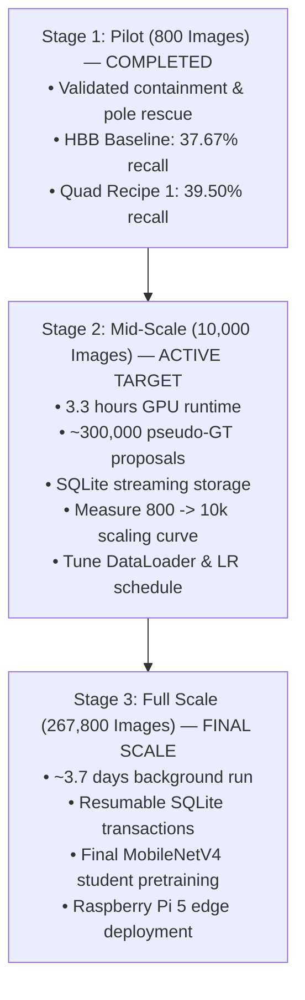

# Staged Scaling Strategy: Scaling SAM Discovery from Pilot to 267k Images

**Document ID:** `03_staged_scaling.md`  
**Status:** Approved Architectural Contract  
**Scope:** Scaling unsupervised SAM pseudo-label generation and MobileNetV4 student training from the 800-image pilot to the full multi-domain dataset.

---

## 1. Executive Summary & Inventory

Having validated the discovery pipeline, containment heuristics, centerness decoupling, and edge decoders on the 800-image pilot, the next objective is scaling training data to maximize the open-world recall of the MobileNetV4 student detector.

### Source Dataset Inventory (from `quad_train.sqlite`):
| Dataset | Domain | Images | Share | Primary Role |
| :--- | :--- | :---: | :---: | :--- |
| **COCO 2017** | General | 118,287 | 44.2% | Diverse object taxonomy, indoor/outdoor variety |
| **BDD100k** | Automotive | 70,000 | 26.1% | Real-world driving, diverse weather and lighting |
| **nuImages** | Automotive | 67,279 | 25.1% | High-resolution multi-camera automotive scenes |
| **WoodScape** | Fisheye | 12,234 | 4.6% | Extreme radial fisheye lens distortion |
| **Total** | — | **267,800** | **100%** | Full visual inference benchmark |

---

## 2. Computational & Data Engineering Realities

### A. The 90-Hour Compute Budget
- **Hardware:** Single NVIDIA GeForce RTX 3060 (12 GB VRAM).
- **Throughput:** SAM ViT-B (with $32 \times 32 = 1,024$ prompt grid, GPU containment checks, and contour extraction) takes $\approx 1.20\text{ seconds per image}$.
- **Full Run Duration:**
  $$\frac{267,800 \times 1.2\text{ s}}{3600} \approx 89.2\text{ hours} \quad (\approx 3.7\text{ days of 100\% non-stop GPU inference})$$

### B. The Monolithic JSON Anti-Pattern
- The 800-image pilot serialized a single 10 MB JSON (`sam_pilot_800.json`).
- At 267,800 images, a single JSON payload would reach **$3.5\text{--}5.0\text{ GB}$**.
- **Failure Modes:**
  1. **RAM OOM:** Deserializing a 4 GB nested JSON into Python objects requires $>20\text{ GB}$ of RAM, crashing standard loaders.
  2. **DataLoader Startup Latency:** Takes 2–4 minutes on every epoch or worker spawn just to parse text JSON.
  3. **Crash Vulnerability:** If a 90-hour job is interrupted at hour 85, an unwritten monolithic JSON leaves zero recoverable records.

---

## 3. The 3-Stage Scaling Roadmap

To de-risk the 90-hour compute investment and establish empirical scaling curves, we adopt a staged progression:



### Stage 1: Pilot Verification (800 Images) — [Completed]
- Proved SAM discovered $+25,728$ novel valid objects missed by human taxonomy.
- Validated aspect-ratio containment rules preserving vertical poles and horizontal road marks.
- Validated HBB superior performance over Quads (47.65% vs. 41.11% on Fisheye).

### Stage 2: Mid-Scale Cohort (10,000 Images) — [Active Target]
- **Stratified Cohort:**
  - COCO 2017: 5,000 images (50%)
  - BDD100k: 2,000 images (20%)
  - nuImages: 2,000 images (20%)
  - WoodScape: 1,000 images (10%)
- **Compute Budget:** $10,000 \times 1.2\text{ s} \approx \mathbf{3.33\text{ hours}}$ on RTX 3060.
- **Yield:** $\approx 300,000$ discovered pseudo-annotations.
- **Core Objectives:**
  1. Verify zero-RAM streaming into SQLite (`sam_discovery.sqlite`).
  2. Train MobileNetV4-Small HBB student for 20 epochs to establish the empirical scaling law ($800 \to 10\text{k}$ recall delta).
  3. Benchmark PyTorch SQLite lazy DataLoader throughput against multi-worker file I/O.

### Stage 3: Full-Scale Cohort (267,800 Images) — [Final Scale]
- **Compute Budget:** $\approx 89.2\text{ hours}$ (run as an unattended background service).
- **Yield:** $\approx 8,000,000$ pseudo-ground-truth proposals across 4 domains.
- **Core Objectives:**
  1. Train production MobileNetV4-Small edge model.
  2. Final export to ONNX / NCNN / TFLite for Raspberry Pi 5.

---

## 4. Technical Specifications for Stage 2 Implementation

### A. Storage Architecture (`sam_discovery.sqlite`)
Replace in-memory JSON accumulation in `run_sam_pilot_discovery.py` with an append-only SQLite schema:

```sql
CREATE TABLE IF NOT EXISTS images (
    image_id INTEGER PRIMARY KEY,
    file_name TEXT NOT NULL,
    source_dataset TEXT NOT NULL,
    width INTEGER NOT NULL,
    height INTEGER NOT NULL,
    processed_at TIMESTAMP DEFAULT CURRENT_TIMESTAMP
);

CREATE TABLE IF NOT EXISTS annotations (
    annotation_id INTEGER PRIMARY KEY AUTOINCREMENT,
    image_id INTEGER NOT NULL,
    bbox_x1 REAL NOT NULL,
    bbox_y1 REAL NOT NULL,
    bbox_x2 REAL NOT NULL,
    bbox_y2 REAL NOT NULL,
    quad_json TEXT, -- Optional [4, 2] polygon coordinates
    source TEXT NOT NULL, -- 'human_gt' | 'sam_discovered'
    is_positive INTEGER NOT NULL, -- 1 for valid object, 0 for suppressed/backdrop
    stability_score REAL NOT NULL,
    FOREIGN KEY(image_id) REFERENCES images(image_id)
);

CREATE INDEX IF NOT EXISTS idx_ann_image ON annotations(image_id);
```

### B. Execution Directives
1. **WAL Mode:** Enable `PRAGMA journal_mode = WAL;` and `PRAGMA synchronous = NORMAL;` for high-throughput concurrent reads and writes.
2. **Atomic Resumability:** Wrap every 50-image batch in a transaction (`BEGIN TRANSACTION` ... `COMMIT`). If interrupted, queries check `SELECT image_id FROM images` to resume instantly with zero duplicated work.
3. **Primary Geometry:** Ensure horizontal bounding boxes $(x_1, y_1, x_2, y_2)$ are indexed as primary columns, keeping quad coordinates serialized in `quad_json` for secondary research use.
