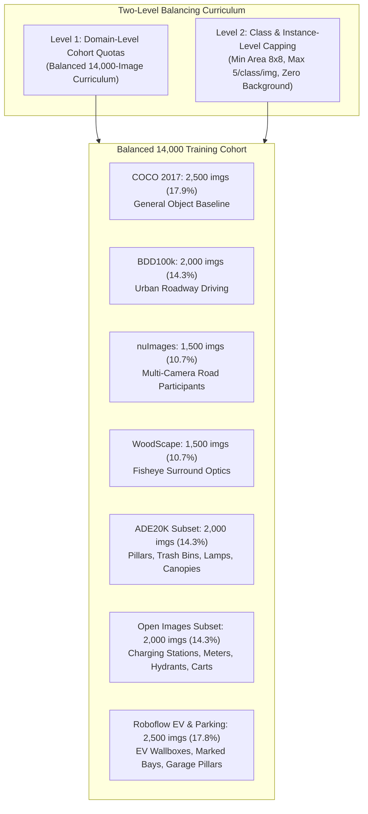

# Implementation Plan: Multi-Domain Dataset Expansion & Limited-Scope Enrichment

**Document ID:** `05_dataset_expansion_plan.md`  
**Status:** Approved Technical Architecture & Operational Roadmap  
**Working Storage:** Local Repo (`data/visual-inference-datasets/`)  
**Archive Storage:** External SSD (`/media/sashamikoff/fb.com-mikoff/datasets/public/incoming_enrichment/archives/`)  
**Target Database:** `quad_train_enriched.sqlite` (Cloned locally from `quad_train.sqlite`)  
**Scope:** Expanding student detector perception across roadside infrastructure and indoor structured parking facilities with a safe, limited-scope Phase 1 curriculum.

---

## 1. Executive Summary & Phased Scoping

The visual inference student detector (`MobileNetV4-Conv-Medium` with P2 Lite-FPN) has achieved solid performance on road traffic participants (vehicles, pedestrians, cyclists), achieving **77.01% GT Recall@100@50** on Quads and **54.38%** on HBBs. However, robust operational deployment across automated parking, low-speed delivery robotics, and curbside perception requires extending detection capabilities to:
1. **Vertical Roadside Furniture & Micro-Infrastructure**: Structural pillars/columns, utility boxes/cabinets, waste containers, street lights, traffic cones, fire hydrants, parking meters, barriers, and clean-energy infrastructure (EV chargers, solar panels).
2. **Indoor Parking Facilities & Underground Garages**: Concrete support pillars, marked parking bays (perpendicular and slanted), ground navigation arrows, low-clearance barriers, and wall-mounted EV charging units under artificial lighting.

### Phase 1 Limited-Scope Strategy:
Rather than ingesting massive raw web corpora that would overwhelm local storage, this roadmap implements a **strictly bounded, high-signal enrichment**:
- **Reuses Existing Corpora**: Preserves our verified BDD100k, COCO 2017, nuImages, and WoodScape Fisheye splits (already present locally in `data/visual-inference-datasets/raw/`).
- **Ingests Exactly Three New Permissive Datasets**:
  1. **ADE20K (SceneParse150)** (BSD-3): Architectural pillars/columns, trash cans, street lamps, signboards, and canopies.
  2. **Open Images V7 (Expanded Domain Subset)** (CC-BY 4.0): Charging stations, parking meters, fire hydrants, solar panels, traffic cones, waste containers, fences, shopping carts, strollers, wheelchairs, and roadside assets.
  3. **Curated Roboflow EV & Parking Dataset** (CC-BY / MIT): Dedicated EV wallboxes/superchargers, indoor parking bays (slanted/perpendicular), ground arrows, and garage pillars.
- **Explicitly Excludes in Phase 1**: Mapillary Vistas 2.0 (commercial license fee), Tongji PS2.0, ApolloScape, and large-scale bulk web dumps.

---

## 2. Storage Topology: Local Working Tree & External SSD Archives

### Storage Capacity:
- **Internal System Disk (`/`)**: 466 GB total, **112 GB available (75% use)** after retiring the legacy 13.5 GB JSON manifests.
- **External SSD (`/media/sashamikoff/fb.com-mikoff`)**: 916 GB total, **424 GB available (52% free)**.

### Hybrid Storage Allocation Policy:
1. **Raw Download Archives & Tarballs**: Downloaded to the **External SSD** to prevent intermediate compression bloat and preserve offline reproducibility.
2. **Extracted Images, Manifests, & Working Database**: Stored **locally** in `data/visual-inference-datasets/` (~8–9 GB total footprint) for maximum NVMe I/O throughput during training.

### Directory Layout:

```
[EXTERNAL SSD] /media/sashamikoff/fb.com-mikoff/datasets/public/incoming_enrichment/archives/
├── ade20k/
│   └── ADEChallengeData2016.zip (~900 MB)
├── open_images_subset/
│   ├── train-annotations-bbox.csv (~75 MB)
│   └── class-descriptions-boxable.csv
└── roboflow_ev_parking/
    └── ev_parking_curated_archives.zip (~600 MB)

[LOCAL WORKSPACE] data/visual-inference-datasets/
├── raw/
│   ├── bdd100k_images_100k/          # Existing (8.4 GB)
│   ├── coco_2017/                    # Existing (31 GB)
│   ├── nuimages/                     # Existing (34 GB)
│   ├── woodscape_rgb_fisheye/        # Existing (26 GB)
│   ├── ade20k/                       # [NEW] Extracted target images & annotations (~500 MB)
│   ├── open_images_subset/           # [NEW] Extracted target images & annotations (~1.5 GB)
│   └── roboflow_ev_parking/          # [NEW] Extracted target images & annotations (~600 MB)
├── output/
│   ├── images/
│   │   ├── train/                    # 274k+ relative symlinks (../../../raw/...)
│   │   └── val/
│   └── indexes/
│       ├── quad_train.sqlite         # Original production index (5.07 GB, pristine)
│       ├── quad_train_enriched.sqlite# [NEW] Local cloned & enriched working database (~5.6 GB)
│       └── quad_val_enriched.sqlite  # [NEW] Local validation database (~350 MB)
```

---

## 3. Database Cloning & Non-Overlapping Namespace Contract

The production training index ([`quad_train.sqlite`](file:///home/sashamikoff/git/skillup/data/visual-inference-datasets/output/indexes/quad_train.sqlite), 267,800 images, 5.07 GB) remains completely untouched and pristine.

### 1. Local Clone Execution:
```bash
# Clone quad_train.sqlite directly within the local indexes directory
cp data/visual-inference-datasets/output/indexes/quad_train.sqlite \
   data/visual-inference-datasets/output/indexes/quad_train_enriched.sqlite
```

### 2. Primary Key Namespace Partitioning:
Existing records occupy IDs `1` through `~267,800`. The new datasets are allocated dedicated non-overlapping numeric ranges:
- **Existing Ingested Corpora**: `1` – `499,999` (BDD100k, COCO 2017, nuImages, WoodScape)
- **ADE20K Subset**: `500,000` – `599,999`
- **Open Images V7 Subset**: `600,000` – `699,999`
- **Curated Roboflow EV & Parking**: `700,000` – `799,999`

### 3. SQLite Schema v8 Strict Compliance:
All inserted rows adhere strictly to the SQLite v8 contract without intermediate JSON files:
- `images` table: `(row_index, image_id, file_name, width, height, source_dataset, camera_type, background_supervision, positive_count)`
- `annotations` table: `(image_id, x1, y1, x2, y2, ignore_region, category_name, object_condition, quad_json, geometry_tier, fit_coverage, fit_tightness, seen_status)`

---

## 4. Open Images V7: Comprehensive Domain Class Catalog

Open Images V7 provides 600 boxable categories under permissive CC-BY 4.0 licensing. We filter exclusively for classes directly applicable to roadside corridors, curbside environments, parking facilities, and robotic navigation hazards.

### Targeted Domain Classes & Rationale:

| Category Group | Open Images MID | Label / Class Name | Target Geometry | Operational Robotics & Domain Rationale |
| :--- | :--- | :--- | :--- | :--- |
| **Curbside & Roadside Infrastructure** | `/m/0g4cdk` | **Charging station** | Tight HBB + Quad | EV charging pedestals, fast-charging cabinets, curbside plugs. |
| | `/m/015p6` | **Parking meter** | Tight HBB | Paid curbside parking markers; vertical sidewalk collision hazards. |
| | `/m/01pns0` | **Fire hydrant** | Tight HBB | Universal curbside obstacle; critical legal no-parking demarcator. |
| | `/m/033rq4` | **Street light** | Tight HBB | Tall vertical poles along roads and parking lot dividers/islands. |
| | `/m/015qff` | **Traffic light** | Tight HBB | Overhead and pole-mounted signals; garage ramp control lights. |
| | `/m/01mqdt` | **Traffic sign** | Tight HBB + Quad | Road signs, parking restriction signs, speed limits, wayfinding. |
| | `/m/02pv19` | **Stop sign** | Tight HBB + Quad | High-priority regulatory signage at garage exits and intersections. |
| | `/m/0159k` | **Traffic cone** | Tight HBB | Temporary work zones, blocked parking spots, lane guides. |
| | `/m/02zn6n` | **Waste container** | Tight HBB + Quad | Curbside wheelie bins, dumpster enclosures, commercial trash bins. |
| | `/m/034c16` | **Mailbox** | Tight HBB | Curbside postal boxes and residential driveway boundary hazards. |
| | `/m/01kn49` | **Billboard** | Tight HBB + Quad | Elevated roadside signage, rate boards at parking lot entries. |
| **Perimeter & Street Furniture** | `/m/015kr` | **Fence** | Tight HBB + Quad | Parking lot perimeter fences, construction barriers, chain-link. |
| | `/m/0cvnqh` | **Bench** | Tight HBB | Sidewalk furniture, pedestrian rest areas in transit hubs. |
| | `/m/01642q` | **Solar panel** | Oriented Quad + HBB | Solar parking canopies, green carport roofs, roadside solar banks. |
| | `/m/02522` | **Porch / Canopy** | Tight HBB + Quad | Overhead garage entrance canopies, carport shade roofs, gas station awnings. |
| | `/m/07j7r` | **Tree** | Tight HBB | Roadside tree trunks and low-hanging branches encroaching on bays. |
| **Parking Hazards & Mobile Obstacles** | `/m/0kmg4` | **Shopping cart** | Tight HBB | Ubiquitous hazard in commercial/retail parking lots; rolls into stalls. |
| | `/m/018xm` | **Baby carriage / Stroller**| Tight HBB | High-vulnerability dynamic hazard in parking lanes and crosswalks. |
| | `/m/0qmmr` | **Wheelchair** | Tight HBB | Accessible ADA parking stalls, loading aisles, pedestrian ramps. |
| | `/m/01s55n` | **Luggage and bags** | Tight HBB | Hotel/airport curbside drop-off zones, temporary aisle clutter. |
| | `/m/0199g` | **Bicycle** | Tight HBB | Two-wheelers parked in or between stalls, rack enclosures. |
| | `/m/04_sv` | **Motorcycle** | Tight HBB | Compact motorized vehicles occupying full or partial parking bays. |
| **Logistics & Commercial Vehicles** | `/m/02q3bx` | **Forklift** | Tight HBB | Industrial parking lots, warehouse loading zones, freight docks. |
| | `/m/078jl` | **Trailer** | Tight HBB + Quad | Detached boat/cargo trailers parked in vehicle stalls or shoulders. |
| **Surface Features** | `/m/02688pb` | **Manhole** | Oriented Quad + HBB | Storm drains, utility access covers on roadway/parking pavement. |

---

## 5. Curated Roboflow EV & Parking Dataset Details

To fill the specific gap in **floor-plane markings** and **niche indoor EV equipment** not covered by standard COCO or Open Images:

1. **EV Infrastructure**:
   - Wallbox chargers (residential & commercial garage walls).
   - High-voltage public DC superchargers.
   - Charging plugs, cables, and holsters.
2. **Indoor Structured Parking Features**:
   - Marked parking bays (perpendicular, parallel, and slanted).
   - Ground navigation arrows (straight, left, right, bidirectional).
   - Concrete basement support pillars and low-clearance overhead hanging beams.
3. **Geometry Treatment**:
   - **Parking slots and ground arrows** are ingested directly as **oriented clockwise 4-corner Quads** (`geometry_tier = 'quad'`).
   - Supervised using Gaussian Wasserstein Distance (GWD) loss + Corner $\mathcal{L}_1$ loss to train the student's `QuadProposalDetector` directly on angled perspective ground planes.
   - Expected yield: **~2,000 to 2,500 annotated images**.

---

## 6. ADE20K SceneParse150 Ingestion Details

ADE20K provides dense scene segmentations across 150 categories with permissive BSD-3 licensing:
- **Class 43**: `column; pillar` &rarr; Concrete support pillars in basements and outdoor arcades.
- **Class 143**: `ashcan; trash can; garbage can; wastebin` &rarr; Street and sidewalk trash bins.
- **Class 41**: `street lamp; streetlight` &rarr; Lighting fixtures and poles.
- **Class 82**: `signboard; sign` &rarr; Directional and parking regulatory signs.
- **Class 87**: `canopy; awning` &rarr; Overhead carport canopies and garage entrances.
- **Contour Extraction**: Segmented instance masks are traced with Douglas-Peucker polygon approximation to yield both tight clockwise 4-corner Quads and bounding envelopes $(x_1, y_1, x_2, y_2)$.
- Expected yield: **~1,500 to 2,000 images**.

---

## 7. Two-Level Data Balancing Curriculum



### 1. Level 1: Domain Cohort Quotas (`STAGE2_COHORT_QUOTAS`)
To prevent dominant highway driving frames from overwhelming rare infrastructure classes:

| Dataset Cohort | Domain Specialization | Quota (Images) | Share | Target Semantic Representation |
| :--- | :--- | :---: | :---: | :--- |
| `coco_2017` | General open-world objects | 2,500 | 17.9% | Persons, bicycles, common objects |
| `bdd100k_images_100k` | Roadway & highway driving | 2,000 | 14.3% | Traffic lights, vehicles, road barriers |
| `nuimages` | Multi-view automotive | 1,500 | 10.7% | Close-proximity road participants |
| `woodscape_rgb_fisheye` | Fisheye surround optics | 1,500 | 10.7% | Fisheye distorted instances, curbs |
| `ade20k` | Architectural & street furniture | 2,000 | 14.3% | **Pillars/columns**, trash cans, canopies |
| `open_images_subset` | Curbside & parking hazards | 2,000 | 14.3% | **EV stations, hydrants, meters, carts, cones** |
| `roboflow_ev_parking` | Indoor garages & EV facilities | 2,500 | 17.8% | **EV wallboxes, parking slots, garage pillars** |
| **Total Enriched Cohort** | **Multi-Domain Unified Curriculum** | **14,000** | **100%** | **Balanced across all operational domains** |

### 2. Level 2: Instance-Level Filtering Rules
- **Zero Empty Background Images**: Every ingested image must contain at least 1 verified target instance.
- **Minimum Resolution Gate**: Discard bounding boxes $< 8 \times 8$ px in raw space to eliminate annotation noise.
- **Instance Capping**: Cap dominant background instances (e.g., maximum 5 cones or signboards per image) so loss backpropagation is not dominated by dense repetitive clusters.
- **Clockwise Quad Normalization**: Enforce top-left clockwise vertex ordering: $(p_0, p_1, p_2, p_3)$.

---

## 8. Dual-Geometry Representation (HBB vs. Quad)

- **Vertical Features** (pillars, EV chargers, parking meters, fire hydrants, trash bins, light poles):
  - Upright orientation in perspective camera views.
  - Supervised by both **HBB** (`StudentDetector`) and oriented **Quad** (`QuadProposalDetector`).
- **Planar Ground Markings** (perpendicular/slanted parking bays, ground navigation arrows, speed bumps):
  - Suffer from severe perspective foreshortening and curvature in wide-angle/fisheye lenses.
  - Axis-aligned HBBs enclose large areas of irrelevant road asphalt, destroying IoU.
  - Supervised exclusively as **oriented 4-corner Quads** using Gaussian Wasserstein Distance (GWD) loss + Corner $\mathcal{L}_1$ loss.

---

## 9. Step-by-Step Implementation Roadmap

```
Phase 1: External SSD Download & Curation
  ├── 1.1 Download ADEChallengeData2016.zip (~900 MB) to SSD: incoming_enrichment/archives/ade20k/
  ├── 1.2 Download Open Images bbox CSV & target images (~1.8 GB) to SSD: incoming_enrichment/archives/open_images/
  └── 1.3 Download curated Roboflow EV & Parking archives (~600 MB) to SSD: incoming_enrichment/archives/roboflow/

Phase 2: Local Ingestion & Database Cloning
  ├── 2.1 Copy quad_train.sqlite -> quad_train_enriched.sqlite locally in data/visual-inference-datasets/output/indexes/
  ├── 2.2 Unpack & extract positive instances directly to local: data/visual-inference-datasets/raw/{ade20k,open_images_subset,roboflow_ev_parking}/
  ├── 2.3 Symlink new images to local: data/visual-inference-datasets/output/images/train/
  ├── 2.4 Implement direct SQLite ingestion scripts:
  │     ├── scripts/ingest_ade20k.py
  │     ├── scripts/ingest_open_images.py
  │     └── scripts/ingest_roboflow_ev_parking.py
  └── 2.5 Atomically insert records into quad_train_enriched.sqlite with isolated namespaces (500k, 600k, 700k)

Phase 3: Validation & Quality Auditing
  ├── 3.1 Verify SQLite integrity (PRAGMA integrity_check, zero FK violations)
  ├── 3.2 Verify image symlinks and resolution bounds
  └── 3.3 Generate visual audit preview (60 samples verifying tight boxes & quads)

Phase 4: DataLoader & Orchestrator Integration
  ├── 4.1 Update STAGE2_COHORT_QUOTAS in student_detector/human_gt_data.py
  ├── 4.2 Update scripts/run_two_stage_pipeline.sh with --gt-index quad_train_enriched.sqlite
  └── 4.3 Run Stage-2 Fine-Tuning across HBB and Quad geometries
```

---

## 10. Verification Plan & Success Criteria

### 1. Storage & Database Safety Gates:
- Root disk `/` space remains $> 90$ GB free at all times (currently 112 GB free).
- Large download archives stay on external SSD.
- Original `quad_train.sqlite` checksum is unchanged; `quad_train_enriched.sqlite` passes `PRAGMA integrity_check`.

### 2. Empirical Model Evaluation Targets:
- **Indoor Support Pillar Recall@100@50**: $> 60\%$ (up from $< 15\%$ baseline).
- **EV Charger (Pedestal & Wallbox) Recall@100@50**: $> 55\%$.
- **Parking Bay Slot & Ground Arrow Quad AP@50**: $> 45\%$.
- **Roadside Furniture (Trash Bins, Hydrants, Meters) Recall@50**: $> 50\%$.
- **Traffic Participant Preservation**: Retains $> 90\%$ of baseline recall on cars, pedestrians, and cyclists without catastrophic forgetting.
