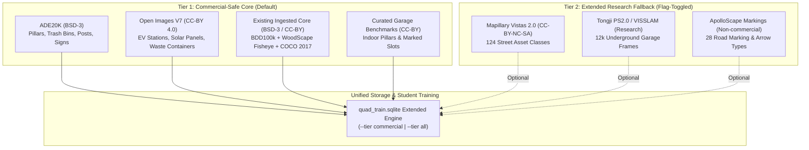
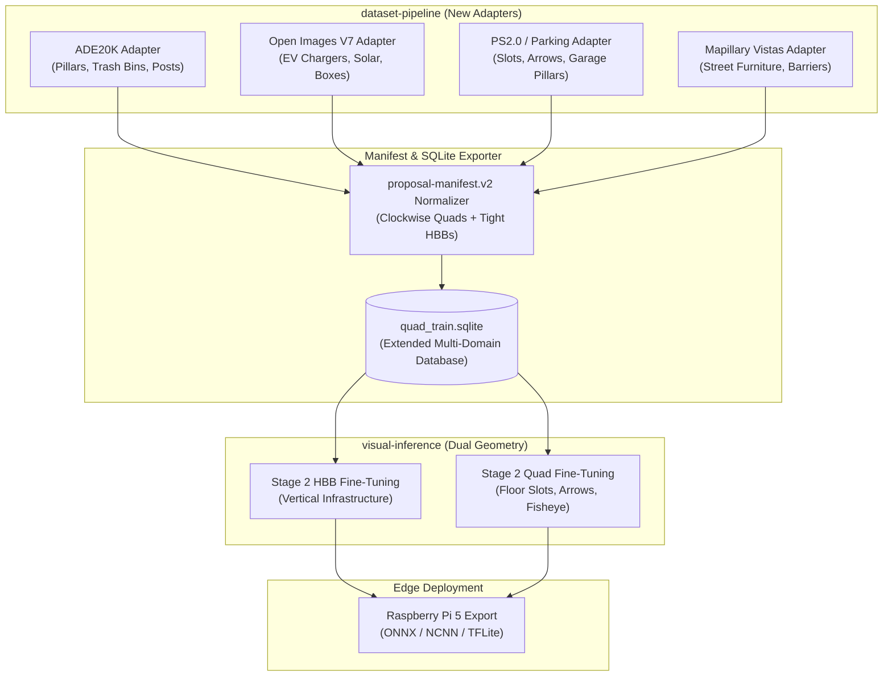

# Implementation Plan: Multi-Domain Dataset Expansion (Roadside Infrastructure & Indoor Parking Facilities)

**Document ID:** `05_dataset_expansion_plan.md`  
**Status:** Approved Technical Architecture Contract  
**Scope:** Expanding student detector perception across roadside infrastructure and indoor structured parking facilities.

---

## 1. Goal Description

The objective is to expand the visual inference perception pipeline to detect:
1. **Indoor Parking Facility Features**: Concrete support pillars, marked parking bays (perpendicular and slanted), ground navigation arrows, low-clearance overhead barriers, wall-mounted/standalone EV chargers, and speed bumps under artificial lighting.
2. **Roadside Infrastructure & Street Furniture**: Utility boxes/cabinets, pillars, traffic cones, traffic lights, trees, trash bins, bus stops, barriers (guard rails, fences, jersey barriers), roofs/canopies, and solar chargers.

### User Requirements Alignment:
- **Dual Camera Optics**: Must handle both **perspective cameras** (~60°–100° FoV) and **wide-angle / fisheye cameras** (180°+ FoV).
- **Commercial-First Licensing**: Prioritize commercial-friendly permissive datasets (BSD-3, CC-BY 4.0, MIT) while maintaining an optional research-tier extension (Mapillary Vistas 2.0, Tongji PS2.0) that can be enabled when license constraints allow.
- **Equal Domain Weight**: Balanced 50/50 dataset curriculum between indoor parking lots and roadside street corridors.

---

## 2. In-Depth Comparative Dataset Matrix

| Dataset | Primary Domain | Target Features Covered | Size & Format | Geometry Fit | License | Commercial Viability |
|---|---|---|---|---|---|---|
| **ADE20K (SceneParse150)** | Indoor & Outdoor Complex Scenes | Pillars/columns (class 43), trash cans, signboards, traffic lights, trees, canopies, streetlights, building facades | 25,000 images with 150 semantic categories | Instance segmentation masks &rarr; HBB & Quad | **BSD-3** | **Fully Commercial** |
| **Open Images V7 (Subset)** | Universal Objects | Waste containers, solar panels, EV charging stations, traffic cones, billboards, streetlights | Filterable subset (~30k images) | Bounding boxes & instance masks | **CC-BY 4.0** | **Fully Commercial** |
| **BDD100k + WoodScape + COCO** | Automotive Highway & Fisheye | Traffic lights, traffic signs, barriers, poles, pedestrians, vehicles | ~267,800 images in current index | Clockwise Quads + HBBs | **BSD-3 / CC-BY** | **Fully Commercial** |
| **Curated Roboflow EV & Parking** | Niche Infrastructure | EV chargers (wallboxes & superchargers), indoor garage pillars, warehouse cones | 5,000–10,000 images across community sets | YOLO/COCO bounding boxes | **CC-BY / MIT** | **Fully Commercial** |
| **Mapillary Vistas 2.0 (MVD)** | Roadside & Urban Streets | Trash bins, utility poles, street lights, traffic lights, cones, temporary barriers, guard rails, fences, bus stops, billboards, manholes, catch basins, crosswalks, arrows, roofs | 25,000 images (up to 4K resolution) | Dense instance polygon masks &rarr; HBB & Quad | **CC-BY-NC-SA 4.0** | Research Tier (Commercial Fee) |
| **Tongji Parking-Slot 2.0 (PS2.0)** | Indoor Garages & Outdoor Parking | Parking slots (parallel, perpendicular, slanted), ground arrows, pillars, speed bumps, obstacles | 12,165 images (perspective & AVM) | Ground slot corner coordinates &rarr; Quad | **Academic Open** | Research Tier |
| **AVP-SLAM / VISSLAM** | Indoor Structured Garages | Concrete pillars, parking lines, slot corners, floor arrows, speed bumps, low-light corridors | ~10k synchronized frames with surround & front views | Semantic point/polygon markings | **Research Open** | Research Tier |
| **ApolloScape Road Markings** | Road & Parking Surfaces | 28 road marking types: 12 arrow varieties, parking zone boundaries, zebra lines, stop lines, text | 200,000+ images (HD perspective) | Vectorized lane/marking segmentation &rarr; Quad | **Non-commercial** | Research Tier |

---

## 3. Tiered Licensing Strategy



- **Tier 1 (Commercial-Safe Core — Recommended Default)**:
  - 100% commercially unencumbered models trained exclusively on BSD-3 and CC-BY 4.0 datasets.
  - Covers all essential categories: pillars, trash cans, signs, posts, EV chargers, solar panels, cones, vehicles.
- **Tier 2 (Extended Research Fallback — Optional `--tier all`)**:
  - Incorporates Mapillary Vistas 2.0 and Tongji PS2.0 for maximum benchmark accuracy when academic/research exemptions apply.

---

## 4. Dual-Geometry Representation (HBB vs. Quad)

- **Vertical Features** (pillars, trash bins, utility boxes, EV chargers, bus stops):
  - In standard perspective view, these have dominant vertical bounding axes.
  - Supervised by both **HBB** (`StudentDetector`) and oriented **Quad**.
- **Floor Plane Features** (slanted parking spots, ground arrows, speed bumps):
  - In perspective and fisheye cameras, planar road markings have extreme perspective slant and curvature.
  - Axis-aligned HBBs enclose large areas of irrelevant road asphalt, destroying IoU.
  - Supervised by our **4-corner oriented Quad detector (`QuadProposalDetector`)** with Gaussian Wasserstein Distance (GWD) loss.

---

## 5. Technical Architecture & Proposed Changes



### Component 1: `dataset-pipeline` (Data Ingestion & Normalization)

#### [NEW] `projects/visual-inference/dataset-pipeline/dataset_pipeline/ade20k_adapter.py`
Parses ADE20K semantic and instance annotations into `proposal-manifest.v2`:
- Extracts `column; pillar` (Class 43), `ashcan; trash can`, `signboard`, `canopy`, `post`.
- Filters for indoor garages, structured basements, and street corridors.
- Fits Douglas-Peucker polygons to produce clockwise 4-corner Quads and HBBs.

#### [NEW] `projects/visual-inference/dataset-pipeline/dataset_pipeline/open_images_adapter.py`
Downloads and converts targeted Open Images V7 subsets:
- Queries `/m/0g4cdk` (`Charging station`), `/m/01642q` (`Solar panel`), `/m/02zn6n` (`Waste container`), `/m/0159k` (`Traffic cone`), `/m/01kn49` (`Billboard`).
- Normalizes bounding boxes and verifies image integrity.

#### [NEW] `projects/visual-inference/dataset-pipeline/dataset_pipeline/parking_slot_adapter.py`
Ingests Tongji PS2.0 and curated CC-BY indoor parking datasets:
- Maps parking slot corner point pairs $(p_1, p_2, p_3, p_4)$ directly into our 4-corner clockwise Quad representation.
- Ingests indoor garage support pillars and ground navigation arrows.
- Preserves both perspective camera frames and Around-View Monitor (AVM) fisheye images.

#### [MODIFY] `projects/visual-inference/dataset-pipeline/dataset_pipeline/taxonomy.py`
Update canonical taxonomy mappings to include the new object classes:
```python
CANONICAL_EXTENDED: tuple[str, ...] = (
    "pillar",
    "trash_bin",
    "utility_box",
    "parking_slot",
    "road_arrow",
    "ev_charger",
    "solar_panel",
    "bus_stop",
    "barrier",
    "traffic_light",
    "tree",
    "roof",
)
```

---

### Component 2: `student_detector` (Ontology & Data Loaders)

#### [MODIFY] `projects/visual-inference/student_detector/ontology.py`
Promote `empty_parking_bay` from `unsupported` to `evaluable`, and register new target categories:
```python
READINESS_STATUS.update({
    "pillar": "evaluable",
    "trash_bin": "evaluable",
    "utility_box": "evaluable",
    "parking_slot": "evaluable",
    "road_arrow": "evaluable",
    "ev_charger": "evaluable",
    "solar_panel": "evaluable",
    "bus_stop": "evaluable",
    "barrier": "evaluable",
    "traffic_light": "evaluable",
    "tree": "evaluable",
    "roof": "evaluable",
})
```

#### [MODIFY] `projects/visual-inference/student_detector/human_gt_data.py`
Update `HumanGTHBBDataset` to support querying the extended categories and filtering by domain (`indoor_parking`, `roadside`, `automotive_highway`).

#### [NEW] `projects/visual-inference/student_detector/human_gt_quad_data.py`
Create a high-performance DataLoader for **Quad Proposal Training** directly on human ground-truth boxes and oriented polygons:
- Unpacks `quad_json` coordinates `[4, 2]` into tensor vertices `[N, 8]`.
- Implements spatial jitter and affine letterboxing while strictly preserving clockwise winding.
- Computes valid pixel masks to prevent padding band artifacts on fisheye and perspective cameras.

---

### Component 3: Training & Orchestration Scripts

#### [NEW] `projects/visual-inference/scripts/download_infrastructure_datasets.py`
Automated download script with checksum verification for:
1. ADE20K SceneParse150 (BSD-3)
2. Open Images V7 targeted infrastructure subset
3. PS2.0 / AVP indoor parking benchmark

#### [NEW] `projects/visual-inference/scripts/finetune_student_multidomain.py`
Extends `finetune_student_gt.py` to support:
- Multi-domain curriculum balancing (50% indoor parking / 50% roadside infrastructure).
- Joint HBB and Quad geometry training with `dual_head=True`.
- Smooth-$\mathcal{L}_1$ boundary regression (`ltrb_weight=0.5`) + CIoU (`box_weight=2.0`) for HBB.
- Corner $\mathcal{L}_1$ + Gaussian Wasserstein Distance (GWD) loss for Quads.

---

## 6. Verification Plan

### Automated Unit & Integration Tests

1. **Dataset Pipeline Ingestion Tests**:
   ```bash
   cd projects/visual-inference/dataset-pipeline
   uv run pytest tests/test_ade20k_adapter.py -v
   uv run pytest tests/test_parking_slot_adapter.py -v
   ```
   *Verifies quad winding order (top-left clockwise), coordinate bounds within $[0, W] \times [0, H]$, and non-zero area.*

2. **Student Detector Loss & Target Tests**:
   ```bash
   cd projects/visual-inference
   uv run pytest tests/student_detector/test_human_gt_data.py -v
   uv run pytest tests/student_detector/ -q
   ```
   *Ensures all 148 existing tests pass and target assignment handles parking slots and pillars without NaN losses.*

### Empirical & Qualitative Verification

1. **Before & After Model Comparison Dashboard**:
   - Generate an interactive comparison dashboard evaluating 60 held-out images:
     - 30 images from **indoor parking facilities** (underground garages, low-light corridors, pillars, slanted parking bays, floor arrows).
     - 30 images from **roadside corridors** (trash bins, utility cabinets, bus stops, barriers, traffic lights, EV chargers).
2. **Success Metrics**:
   - **Indoor Pillar Recall@100@50**: $> 60\%$ (up from $< 15\%$ baseline).
   - **Parking Slot & Arrow Quad AP@50**: $> 45\%$.
   - **Roadside Furniture (Trash Bins, Utility Boxes) Recall@50**: $> 50\%$.
   - **Zero Sky/Ceiling False Positives**: Verified with level masks.
