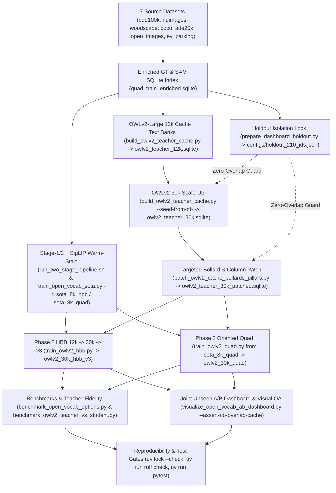

# OWLv2 End-to-End Development Pipeline & Engineering Decisions

This document is the authoritative record of the end-to-end development, distillation, training, evaluation, and verification pipeline for [`projects/visual-inference`](../README.md), together with the architectural and empirical decisions (`D1`–`D9`) behind the active HBB (`owlv2_30k_hbb_v3`) and Oriented Quad (`owlv2_30k_quad`) detectors.

For concise active runtime contracts and invariants, see [`../ARCHITECTURE.md`](../ARCHITECTURE.md). For offline vocabulary bank generation and Option A/B classification usage, see [`open_vocabulary_embedding_guide.md`](open_vocabulary_embedding_guide.md). Historical SigLIP/Phase-1–4 notes remain archived under [`history/`](history/).

---

## 1. End-to-End Development Pipeline

### Stage-by-Stage Reference & Verification Gates

| Stage | Script / Module | Primary Inputs | Key Outputs | Verification Gate |
|---|---|---|---|---|
| **1. Dataset Ingest & Enrichment** | [`../dataset-pipeline/README.md`](../dataset-pipeline/README.md), [`../scripts/ingest_ade20k.py`](../scripts/ingest_ade20k.py), [`../scripts/ingest_open_images.py`](../scripts/ingest_open_images.py), [`../scripts/ingest_roboflow_ev_parking.py`](../scripts/ingest_roboflow_ev_parking.py) | 7 source datasets | `quad_train_enriched.sqlite`, `sam_discovery_enriched.sqlite` | deterministic `ORDER BY rowid` queries |
| **2. Holdout Lockfile & Manifest** | [`../scripts/prepare_dashboard_holdout.py`](../scripts/prepare_dashboard_holdout.py), [`../student_detector/data_isolation.py`](../student_detector/data_isolation.py), [`../student_detector/dashboard_holdout.py`](../student_detector/dashboard_holdout.py) | `quad_train_enriched.sqlite`, `sam_discovery_enriched.sqlite` | `artifacts/dashboard_holdout_8k_8k_full.json`, [`../configs/holdout_210_ids.json`](../configs/holdout_210_ids.json) | `test_dashboard_holdout.py` (`0` overlap between `holdout_210`, `7,200` train IDs, and `800` SAM pilot hashes) |
| **3. Stage-1/2 & `sota_8k_*` Warm-Start** | [`../scripts/run_two_stage_pipeline.sh`](../scripts/run_two_stage_pipeline.sh), [`../scripts/train_open_vocab_sota.py`](../scripts/train_open_vocab_sota.py) | `quad_train_enriched.sqlite`, holdout manifest | `artifacts/sota_8k_hbb/`, `artifacts/sota_8k_quad/` (`sota_joint_best.pt`) | Dual-head 128-ch `P2LitePAN` + 3DMF checkpoints verified on `cohort_val_800` |
| **4a. OWLv2-12k → 30k Teacher Cache** | [`../scripts/build_owlv2_teacher_cache.py`](../scripts/build_owlv2_teacher_cache.py), [`../student_detector/owlv2_teacher.py`](../student_detector/owlv2_teacher.py) | `google/owlv2-large-patch14-ensemble` (`95e26936...`), `quad_train_enriched.sqlite`, `annotation_hygiene.py` | `owlv2_teacher_12k.sqlite` → `owlv2_teacher_30k.sqlite`, `owlv2_vocabulary_bank_*.pt` | Parity check vs HuggingFace forward, WAL → `DELETE` flatten, `0` NaNs, crowd-split & stratified PNG QA |
| **4b. Bollard/Column Cache Patch** | [`../scripts/patch_owlv2_cache_bollards_pillars.py`](../scripts/patch_owlv2_cache_bollards_pillars.py) | `owlv2_teacher_30k.sqlite`, non-ADE20K driving splits | `owlv2_teacher_30k_patched.sqlite` (`+4,164 pole`, `+3,818 pillar` total across 10k sampled images) | `0` NaNs, `0/236` train-dashboard overlap, before/after PNG QA |
| **5a. Phase 2 HBB (`v3`)** | [`../scripts/train_owlv2_hbb.py`](../scripts/train_owlv2_hbb.py), [`../student_detector/targets.py`](../student_detector/targets.py), [`../student_detector/losses.py`](../student_detector/losses.py) | `sota_8k_hbb` → `owlv2_12k_hbb` (12 ep) → `owlv2_30k_hbb` (6 ep) → `owlv2_30k_hbb_v3` (3 ep) | `owlv2_hbb_best.pt`, `owlv2_adapted_vocab_*.pt` | `--max-steps` smoke run + full val eval (`composite_score=0.5738`) |
| **5b. Phase 2 Oriented Quad** | [`../scripts/train_owlv2_quad.py`](../scripts/train_owlv2_quad.py), [`../student_detector/quad_targets.py`](../student_detector/quad_targets.py), [`../student_detector/quad_losses.py`](../student_detector/quad_losses.py) | `sota_8k_quad` (`strict=True`), `owlv2_teacher_30k_patched.sqlite` | `owlv2_quad_best.pt` (6 ep, `0.92 s/step`), `owlv2_adapted_vocab_*.pt` | Pre-run 20-step speed & recall gate (`R@100=45.5%`, `loss_det=2.15`) + Ep 6 (`composite_score=0.5647`) |
| **6. Benchmark, Fidelity & Visual QA** | [`../scripts/benchmark_open_vocab_options.py`](../scripts/benchmark_open_vocab_options.py), [`../scripts/benchmark_owlv2_teacher_vs_student.py`](../scripts/benchmark_owlv2_teacher_vs_student.py), [`../scripts/visualize_open_vocab_ab_dashboard.py`](../scripts/visualize_open_vocab_ab_dashboard.py) | HBB `v3` & Quad checkpoints, Core-27/31/37/41 banks, `holdout_210` & `cohort_val_800` | `benchmark_*.json`, `dashboard_open_vocab_a_b_ab.html`, `0`-overlap audit | `--assert-no-overlap-cache` (`0/236`), `node --check` on embedded JS, visual PNG inspection, `uv run ruff check`, `uv run pytest` |

> **Offline Archives & Recovery**: See [`../README.md`](../README.md#offline-archives--full-recovery) for the full offline raw-archive inventory (`nuImages`, `COCO 2017`, `WoodScape`, `BDD100K`, `ADE20K`, `Open Images`, `PKLot`), compact SSD backup layout, and Git [`../release/`](../release/) quickstart.

---

## 2. Engineering Decision Log (ADRs)

### D1 — Unified OWLv2-Large Teacher over SigLIP Crop Distillation
- **Decision**: Distill directly from **OWLv2-Large** ([`../student_detector/owlv2_teacher.py`](../student_detector/owlv2_teacher.py), `OWLV2_MODEL_ID = "google/owlv2-large-patch14-ensemble"` pinned to `OWLV2_MODEL_REVISION = "95e26936e865f87db1742128404b3c035d47d89d"`) rather than crop-only SigLIP embeddings.
- **Why / Evidence**: Crop-only SigLIP distillation suffered from two structural ceilings: (1) federated source datasets leave many categories unannotated (`SOURCE_ANNOTATED_CATEGORIES`), so crop distillation alone cannot teach missing boxes or split merged pedestrian groups, and (2) SigLIP crop embeddings yielded only `60.2% / 61.5%` ZeroShot-4 (`cohort_val_800 / holdout_210`) and `70.4% / 71.3%` Opt-B Seen Top-1. OWLv2-Large supplies unified detection boxes + native 768-D `class_embeds` (`73.01%` Top-1 / `89.17%` Top-3 over `274,299` matched Human GT across the 30k cache), jumping student ZeroShot-4 to **`94.7%–97.3%`** and Opt-B Seen Top-1 by **`+12–15pp`** (`83.6%–86.5%`).
- **Rejected Alternative**: Continuing SigLIP crop distillation with heavier hard-negative mining (cannot fix missing pseudo-boxes or crowd pedestrian groups).

### D2 — Non-Destructive In-Memory Annotation Hygiene
- **Decision**: Implement all GT cleanup in [`../student_detector/annotation_hygiene.py`](../student_detector/annotation_hygiene.py) (`sanitize_image_annotations`) and apply it consistently across training loaders (`HumanGTHBBDataset`, `HumanGTQuadDataset`), evaluation (`semantic_evaluation_data.py`), dashboard GT overlays, and SAM discovery masking.
- **Why / Evidence**: Source SQLite annotations contain two systematic defects: (1) `nuimages` / `coco_2017` carry both `source_hbb` and `fitted_quad` rows for the same object (or occluded multi-fragment `fitted_quad` sub-pieces inside a single `source_hbb`), and (2) `woodscape_rgb_fisheye` polygon masks generate noisy tiny/nested fragments (`IoMin >= 0.70`, `<16px`, or `<32px` major axis for `pole`). Filtering in memory deduplicates `source_hbb` vs `fitted_quad` (`IoU >= 0.50`), collapses occluded `fitted_quad` sub-pieces (`IoU >= 0.30` or `IoMin >= 0.70`) back to their enclosing `source_hbb`, demotes noisy WoodScape fragments to `ignore_region = 1`, and preserves raw positive `gt_indices` cache offsets without invalidating precomputed SQLite caches.
- **Rejected Alternative**: Mutating `quad_train_enriched.sqlite` rows in place (breaks positional `gt_indices` cache indexing and makes ablation against raw GT non-reversible).

### D3 — Teacher Target Merging, Crowd Splitting, Stuff Capping, WoodScape Ego-Hood Suppression & Bollard/Pillar Patch
- **Decision**: Combine cleaned Human GT with OWLv2 detections inside `merge_clean_gt_and_owlv2` ([`../student_detector/owlv2_teacher.py`](../student_detector/owlv2_teacher.py#L192-L350)), followed by a targeted 10k bollard/column cache patch ([`../scripts/patch_owlv2_cache_bollards_pillars.py`](../scripts/patch_owlv2_cache_bollards_pillars.py)).
- **Why / Evidence**:
  - **Pedestrian Crowd Splitting**: Replaces merged group pedestrian GT boxes only when `>= 2` non-overlapping (`IoU < 0.35`) OWLv2 `pedestrian` detections (`score >= CROWD_PED_MIN_SCORE = 0.27`) satisfy `_iomin(ob, g_box) >= 0.70`, `o_area <= 0.65 * g_area`, `o_h >= 0.45 * g_h`, `o_w <= 0.72 * g_w`, and horizontal center spread `max(cx) - min(cx) >= 0.25 * g_w` — splitting true crowds while preventing single-person vertical torso/leg splits.
  - **Stuff Capping & Negative Dead-Zone Guard**: Scene-stuff pseudo-labels (`building`, `tree`, `fence`) are capped at `OWLV2_MAX_STUFF_AREA = 0.50`, and both OWLv2 `TargetBuilder` and `QuadTargetBuilder` pass `max_one_to_one_interior_area_frac = 0.20` (default `0.90` in unit-tested standalone classes) so large backdrop boxes do not suppress smaller foreground anchors in primary 1-to-1 matching.
  - **WoodScape Ego-Hood Suppression**: Drops `woodscape_rgb_fisheye` teacher false positives (`construction_barrier`, `fence`, `building`, plus patch `pole`/`pillar`) in the lower fisheye hood zone (`cy_frac >= WOODSCAPE_EGO_HOOD_MIN_Y_FRAC = 0.58` and `area_frac >= WOODSCAPE_EGO_HOOD_MIN_AREA_FRAC = 0.12`).
  - **Targeted 10k Bollard/Pillar Patch**: Driving datasets under-label roadside bollards and architectural columns. Running `OWLV2_PATCH_BOLLARD_PILLAR_PROMPTS` (`bollard`, `metal bollard` → `pole`; `pillar`, `concrete column`, `building column` → `pillar`) over 10k images added `+4,164 pole` and `+3,362 pillar` in `nuimages` plus `+456 pillar` in `woodscape_rgb_fisheye` (`0` NaNs) into `owlv2_teacher_30k_patched.sqlite`.
- **Rejected Alternative**: Re-running the full 30k OWLv2 extractor from scratch after prompt updates (wastes hours when `sqlite3.backup` + `merge_patch_owl_detections` appends safely without disturbing existing embeddings).

### D4 — Core-27 Deployment Preset & L2-Clamped Prototype Residuals
- **Decision**: Train closed-set supervised calibration over **`CORE_27_CATEGORIES`** (`street_light -> pole` via `CLOSED_MERGE_MAP`; 9 scarce/noisy classes omitted via `PRUNED_SCARCE_CATEGORIES`) with **L2-clamped (`||delta|| <= 0.12`) prototype residuals** `normalize(t_k + delta_k)` while distilling native 768-D OWLv2 visual embeddings across all `37` seen + unseen categories ([`../student_detector/ontology.py`](../student_detector/ontology.py), [`../scripts/train_owlv2_hbb.py`](../scripts/train_owlv2_hbb.py)).
- **Why / Evidence**: Deploying Core-27 via `VocabularyBank.subset(CORE_27_CATEGORIES)` removes confusing label collisions (`street_light` vs `pole`, where OWLv2 teacher itself scored `pole=38.1%` in 37-class vs `69.5%` in Core-27) while keeping the Full-37 bank and arbitrary zero-shot text prompts functional on the exact same weights. Clamping `core_proto_delta` to `0.12` boosts seen-class Top-1 (`+1.5–2.3pp` over frozen OWLv2 text banks) without breaking alignment to frozen open-vocabulary text vectors (`ZeroShot-4 = 94.7%–97.3%`).
- **Rejected Alternative**: Replacing open-vocab cosine scoring with a fixed 27-way linear classifier (loses zero-shot extensibility) or unconstrained text-prototype fine-tuning (drifts unseen classes off the OWLv2 manifold).

### D5 — Dual Open-Vocabulary Heads (Option A vs Option B) & OWLv2 Sigmoid Calibration
- **Decision**: Co-train **Option A (`DenseAnchorSemanticHead`, `0.135M` params)** and **Option B (`RoIPooledSemanticHead`, `2.875M` params)** under `teacher_space="owlv2"` (`init_scale=20.0`, `init_bias=-6.5`, no visual-centroid/median subtraction, `1.5x` distractor margin veto `+0.02`, `0.25x` top-1 margin) inside [`../student_detector/open_vocab_heads.py`](../student_detector/open_vocab_heads.py).
- **Why / Evidence**:
  - **Option A** uses a 2-layer depthwise-separable tower + `1x1` projection (`zero` RoIAlign ops), enabling static Conv2d graph export (`forward_dense`) bit-exact with sparse `forward_indexed`.
  - **Option B** pools `5x5` dual-scale focal (`0.15`) + context (`0.45`) RoI features with **no `[xc/W, yc/H]` coordinate shortcut**, gaining `+2.4–5.3pp` seen Top-1 over Option A (`83.6%–86.5%` vs `78.3%–82.4%`) at lower E2E FLOPs when `N=25` proposals (`8.60 GFLOPs` Opt-B vs `11.40 GFLOPs` Opt-A dense).
  - Sigmoid calibration + 7 background distractors avoids forced softmax competition on empty/background proposals.
- **Rejected Alternative**: Feeding normalized box center coordinates into the RoI projector (induced vertical street-position shortcuts) or keeping SigLIP centroid offset on OWLv2 features (miscalibrated sigmoid priors).

### D6 — Raw-IoU Quality Targets, `pillar` `1.0x` Sampling, & Small-Box Decoder Calibration (`p=1.25, top_k=1000`)
- **Decision**: Remove the discontinuous `<16px sqrt(IoU)` quality-target inflation in `ProposalLoss` and `QuadProposalLoss` (`use_proxy_quality_floor=False`), restore `"pillar"` to `1.0x` sampling weight, and standardize inference decoding at `small_box_min_side=16.0`, `small_box_score_power=1.25`, `pre_nms_top_k=1000`, `max_detections=100` across both [`../student_detector/decoder.py`](../student_detector/decoder.py) and [`../student_detector/quad_decoder.py`](../student_detector/quad_decoder.py) (where Quad ranks candidates by clamped envelope while running `quad_validity` pre-clamp).
- **Why / Evidence**: Visual failure inspection of middle-frame cars (`#255981`, `#256231`) traced small-box crowding to tiny sub-`16px` clutter receiving artificially elevated `sqrt(IoU)` objectness targets plus overly high `pillar` oversampling. Fixing the training target + mild `p=1.25, tk=1000` decoding:
  - Lifted HBB `v3` `AP50` (`10.0% -> 11.7%` holdout, `12.4% -> 13.8%` val) and Opt-B Top-1 (`86.0% -> 86.5%` holdout) while reducing post-semantic overlap (`2.90 -> 2.25`).
  - Lifted Quad `AP50` (`15.8% -> 16.9%` holdout), cut post-semantic overlap by **`-31%` to `-41%`** (`1.35 -> 0.80` val; `1.83 -> 1.27` holdout), and nearly **halved Quad 4-thread CPU E2E latency** (`317.06ms -> 155.83ms`) and GPU latency (`32.53ms -> 22.10ms`).
- **Rejected Alternative**: Applying `p=1.5` post-hoc alone without fixing `<16px sqrt(IoU)` training targets (compensated symptoms while leaving teacher-student objectness calibration distorted).

### D7 — Full `sota_8k_quad` Warm-Start vs. Hybrid HBB-FPN Warm-Start for Quad
- **Decision**: Warm-start `scripts/train_owlv2_quad.py` directly from full `sota_8k_quad` (`QuadProposalDetector`, `strict=True`, `588` keys) with fresh OWLv2 Option A/B heads on `owlv2_teacher_30k_patched.sqlite`.
- **Why / Evidence**: Hybrid warm-start experiments combining HBB `v3` backbone/FPN weights with fresh or `sota_8k_quad` corner-regression heads collapsed during pre-run 20-step verification (`loss_det = 5.74–5.79`, `R@100 = 0.7%–1.0%`), because the FPN feature distribution adapted for FCOS `ltrb` offsets does not match 8-channel corner regression (`[B, 8, H_l, W_l]`). Strict-loading full `sota_8k_quad` immediately started at **`R@100 = 45.5%`, `loss_det = 2.15`** and converged in **6 epochs (`198.77 min`, `0.924 s/step` steady)** to `composite_score = 0.5647`, `83.8%/83.6%` Top-1, and `92.7%/97.3%` ZeroShot-4 (`100.0%` 31-way Top-5).
- **Rejected Alternative**: Transplanting HBB `v3` backbone/FPN into `QuadProposalDetector` (`0.7%–1.0%` recall failure).

### D8 — Training, Numerical, & Data-Isolation Invariants
- **Decision**: Enforce the following non-negotiable runtime invariants:
  - **BN Freezing**: Call `freeze_backbone_batch_norm(system.detector)` every epoch (conv weights and BN affine `gamma`/`beta` remain trainable, preventing shared `P2`–`P5` running-stat corruption at `batch_size=16`).
  - **Epoch-1 Detach & Differential Features**: Primary head consumes `detached_features` while dense `aux_head` drives FPN/backbone gradients; fresh OWLv2 runs detach semantic heads during Epoch 1 (`detach_sem = (epoch == 1) and (not resumed)`).
  - **FP32 Geometry & Losses under AMP**: `384^2 = 147,456 > 65,504` (FP16 max); compute quad geometry, `_quality_focal_loss`, `OpenVocabularySigmoidLoss` logits, and `train_proposal_decoder` in FP32.
  - **SQLite Safety & Pinning**: Flatten WAL journals (`PRAGMA journal_mode=DELETE`) before read-only `immutable=1` readers; query deterministic `ORDER BY rowid`; enforce `torch.multiprocessing.set_sharing_strategy("file_system")`.
  - **Leakage & Reproducibility Locks**: Pin `torchvision>=0.22.0` (`uv.lock`), pin `OWLV2_MODEL_REVISION`, track `configs/holdout_210_ids.json`, and gate dashboard generation with `--assert-no-overlap-cache` (`0/236` train overlap verified).

### D9 — Local-Only Training & CI Execution Policy
- **Decision**: Remove `.github/workflows/` cloud-training reconciler, Packet GPU dispatcher, and GitHub Actions CI workflows; execute training locally on workstation GPU (RTX 3060) and verify locally with `uv lock --check`, `uv run ruff check student_detector/ scripts/ tests/`, and `uv run pytest`.
- **Why / Evidence**: Eliminates unused remote workflow maintenance and drift between GitHub runners and the local workstation `uv` / CUDA environment, while keeping `.github/copilot-instructions.md -> ../AGENTS.md` intact.

---

## 3. Benchmark Progression & Teacher Fidelity

All numbers below are evaluated on sanitized Human GT (`p=1.25, top_k=1000, max_detections=100` unless noted otherwise; `Val / Holdout` = `cohort_val_800 / holdout_210`).

### HBB & Quad Evolution

| Stage / Variant | Preset / Decoder | `R@100@50` (Val / Holdout) | `AP50` (Val / Holdout) | Opt-A Top-1 | Opt-B Top-1 (`mAP@50`) | Opt-AB Top-1 (`mAP@50`) | ZS4 Opt-B (4w / Top-5) | PostOvlp (Val / Hold) | E2E Opt-B (CPU / GPU) |
|---|---|---:|---:|---:|---:|---:|---:|---:|---:|
| **SigLIP-8k HBB** *(legacy baseline)* | `37-cls`, native | `43.2% / 43.1%` | `—` | `70.8% / 72.2%` | `70.4% / 71.3%` (`7.7% / 12.9%`) | `73.1% / 73.7%` | `60.2% / 61.5%` | `2.67 / 3.34` | `288.7ms / 42.4ms` |
| **SigLIP-8k Quad** *(legacy baseline)* | `37-cls`, native | `—` | `—` | `63.1% / 62.2%` | `64.5% / 61.9%` | `65.9% / 63.4%` | `70.1% / 74.4%` | `0.69 / 0.82` | `—` |
| **OWLv2-12k HBB** | Frozen `37-cls` | `48.9% / 47.5%` | `—` | `77.9% / 78.4%` | `81.0% / 82.5%` (`9.4% / 10.2%`) | `80.6% / 81.8%` | `94.5% / 97.1%` (`98.6% / 100%`) | `2.81 / 3.24` | `179.0ms / —` |
| **OWLv2-12k HBB** | Adapted `Core-27` in 37 | `—` | `—` | `79.7% / 80.7%` | `83.4% / 84.0%` (`10.8% / 11.7%`) | `82.7% / 83.1%` | `94.5% / 97.1%` | `2.68 / 3.19` | `205.8ms / —` |
| **OWLv2-30k HBB** *(pre-patch)* | Adapted `Core-27`, `p=1.0` | `52.1% / 50.8%` | `9.9% / 8.1%` | `81.1% / 81.6%` | `84.5% / 85.3%` (`16.1% / 18.4%`) | `83.9% / 84.9%` (`16.5% / 18.1%`) | `93.0% / 97.1%` (`98.1% / 97.1%`) | `2.50 / 3.42` | `209.0ms / —` |
| **OWLv2-30k HBB** *(pre-patch)* | Adapted `Core-27`, `p=1.5` | `52.4% / 51.3%` | `12.0% / 10.2%` | `81.2% / 82.0%` | `84.2% / 85.3%` (`16.3% / 18.3%`) | `83.9% / 85.5%` (`16.8% / 18.1%`) | `94.8% / 94.1%` | `1.76 / 2.74` | `136.3ms / —` |
| **OWLv2-30k HBB `v3`** *(active)* | Native (`p=1.0, tk=500`) `Core-27` | `53.5% / 50.8%` | `12.4% / 10.0%` | `81.0% / 82.3%` | `84.1% / 86.0%` (`15.1% / 16.6%`) | `83.9% / 86.0%` (`15.6% / 16.8%`) | `94.9% / 97.3%` (`98.1% / 100%`) | `2.03 / 2.90` | `205.7ms / 53.9ms` |
| **OWLv2-30k HBB `v3`** *(active winner)* | Decal (`p=1.25, tk=1000`) `Core-27` | **`53.9% / 51.6%`** | `13.8% / 11.7%` | **`80.9% / 82.4%`** | **`84.0% / 86.5%`** (`15.1% / 16.6%`) | **`83.8% / 86.3%`** (`15.7% / 16.9%`) | `95.4% / 94.7%` (`97.4%` AB) | `1.54 / 2.25` | `247.3ms / 22.2ms` |
| **OWLv2-30k HBB `v3`** *(Full-37)* | Decal (`p=1.25, tk=1000`) `37-cls` | `53.9% / 51.6%` | `13.8% / 11.7%` | `78.7% / 81.1%` | `82.7% / 85.7%` (`12.1% / 15.8%`) | `82.3% / 85.2%` (`12.6% / 16.4%`) | `—` | `—` | `178.1ms / 18.0ms` |
| **OWLv2-30k Quad** *(active)* | Native (`p=1.0, tk=500`) `Core-27` | `51.6% / 50.6%` | `16.6% / 15.8%` | `79.6% / 78.3%` | `83.8% / 83.7%` (`14.4% / 11.9%`) | `83.5% / 82.8%` (`15.2% / 13.6%`) | `92.3% / 94.7%` (`98.7% / 100%`) | `1.35 / 1.83` | `317.1ms / 32.5ms` |
| **OWLv2-30k Quad** *(active winner)* | Decal (`p=1.25, tk=1000`) `Core-27` | `51.9% / 50.6%` | **`17.5% / 16.9%`** | `79.7% / 78.3%` | `83.8% / 83.6%` (`14.6% / 12.1%`) | `83.6% / 82.7%` (`15.5% / 13.5%`) | `92.7% / 97.3%` (`98.7% / 100%`) | **`0.80 / 1.27`** | **`155.8ms / 22.1ms`** |
| **OWLv2-30k Quad** *(Full-37)* | Decal (`p=1.25, tk=1000`) `37-cls` | `—` | `—` | `78.0% / 77.3%` | `82.4% / 82.5%` (`11.8% / 12.1%`) | `82.1% / 81.8%` (`12.4% / 13.4%`) | `—` | `—` | `156.6ms / 22.4ms` |

### OWLv2-Large Teacher vs. Student `v3` (`holdout_210`)
- **Teacher (`google/owlv2-large-patch14-ensemble`, `1008×1008`, `437.61M` params, `282.55 ms` RTX 3060 `bsz=1`)**:
  - `Core-27 Frozen`: `R@100@50 = 70.0%`, `R@100@75 = 37.9%`, `AP50 = 20.5%`, `Top-1 = 86.9% / Top-3 = 96.8%` (`n=1,453`), `mAP@50 = 31.5%`, `ZS4 = 96.2% / 96.2%` (`pole = 69.5%`, `pillar = 100%`, `trash_bin = 100%`, `car = 94.5%`, `pedestrian = 92.7%`).
  - `Full-37 Frozen`: `R@100@50 = 70.6%`, `Top-1 = 84.5% / Top-3 = 95.8%`, `mAP@50 = 31.4%`, `pole = 38.1%`.
- **Direct Distillation Fidelity (`owlv2_30k_hbb_v3` vs `2,256` OWLv2-Large boxes `>= 0.28` on `holdout_210`)**:
  - **`55.4%`** teacher-box `Recall@50`, **`85.2%`** Top-1 / **`96.8%`** Top-3 label agreement, and **`0.8024`** mean (**`0.8278`** median) matched 768-D cosine similarity (`0.7537` mean / `0.7762` median on Oracle GT).
  - Student retains **`99.5%`** of teacher semantic Top-1 in Core-27 (`86.5%` vs `86.9%`) and **exceeds** the teacher on Full-37 (`85.7%` vs `84.5%`, `+1.2pp`), while running **`13×–16×` faster** at **`43×` fewer parameters**.

---

## 4. Compute Profile, SOTA Gap Analysis & Deployment Roadmap

### Measured Compute & Parameter Budget (`384×384`, `bsz=1`)
- **Detector Core (`MobileNetV4-Conv-M + P2LitePAN + Primary 3DMF Head`)**: **`7.31M`** inference params, **`8.12–8.13 GFLOPs`** (`4.06–4.07 GMACs`) across HBB & Quad.
- **Option A (`DenseAnchorSemanticHead`)**: `+0.135M` params → **`7.44M` total**, **`11.39–11.40 GFLOPs`** full-dense (`zero` RoI ops).
- **Option B (`RoIPooledSemanticHead`)**: `+2.875M` params → **`10.18M` total**, **`8.60 GFLOPs`** at 25 proposals.

### Where the Model Stands vs. SOTA
- **Compute vs. Published Edge Open-Vocab Models**: At `8.60–11.40 GFLOPs`, the `384×384` student uses **`2.5×–6×` fewer FLOPs** than typical `640×640` open-vocabulary YOLO models (e.g., YOLOE-11-S / YOLO-Worldv2-S at `~21.5–45+ GFLOPs`) while preserving native oriented-quad prediction.
- **Two Remaining Bottlenecks**:
  1. **Spatial Resolution (`384×384` vs `640×640` / `1008×1008`)**: Semantic classification already matches OWLv2-Large (`~86.5%` Top-1, `94.7%–97.3%` ZeroShot-4); the gap to SOTA `mAP@50` (`16.6%` vs `31.5%`) comes from proposal localization (`R@100@50 = 51.6%` vs `70.0%`) and sub-`12px` distant objects on `384×384` pixels.
  2. **Uncompiled Eager PyTorch Overhead**: Current timings (`22.1–22.2 ms` GPU; `155.8–247.3 ms` 4-thread CPU) reflect eager PyTorch dispatch rather than compiled TensorRT / NCNN kernels.

### Concrete Next Engineering Levers
1. **ONNX → TensorRT / NCNN + Algebraic Option-A Weight Folding**: Export `MobileNetV4 + P2LitePAN + Primary Head + Option A` as a static Conv2d graph without `MultiScaleRoIAlign`, and pre-multiply Option A's `1×1` projection with the active normalized `[C, 768]` `VocabularyBank` at load time when normalization/scaling is handled cleanly in deployment.
2. **`512×512` Resolution Fine-Tune**: Raise input canvas (`divisible by 32`) on the existing `owlv2_teacher_30k_patched.sqlite` cache to lift small-object `R@100@50` and `mAP@50` closer to OWLv2-Large while remaining well below `640×640` SOTA FLOPs.
3. **Class-Conditioned Option-A Scoring / Distillation**: Narrow the Option A vs Option B Top-1 gap (`82.4%` vs `86.5%`) so zero-RoI static graphs match RoI-pooled accuracy.
